# PublicFlow

**An AI-assisted platform that turns a citizen's photo of a city problem into a tracked municipal ticket.**
(Repository and package name: *Municipalité Automatisée*.)

This is a university project (Advanced Deep Learning) built by a team of five students. It demonstrates **multimodal AI, prompt engineering, RAG (Retrieval-Augmented Generation), multi-agent orchestration, workflow automation, deterministic validation and human review**.

<p align="center">
  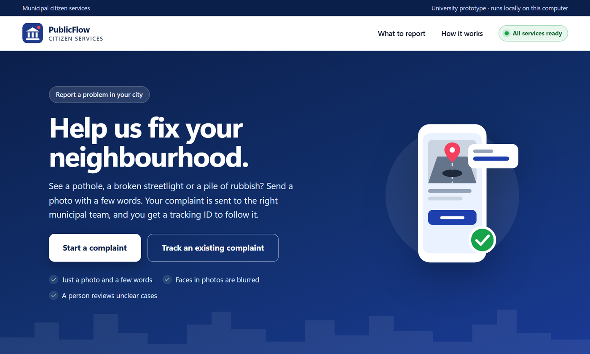
</p>

> **Status:** a local demonstration. It has run end to end with real AI models and saved real database tickets. It is **not** a production system. See [Current status and limitations](#14-current-status-and-limitations) for an honest list of what is missing.

---

## Table of contents

1. [The idea in one minute](#1-the-idea-in-one-minute)
2. [See it in action: how a citizen files a complaint](#2-see-it-in-action-how-a-citizen-files-a-complaint)
3. [What the citizen gets back](#3-what-the-citizen-gets-back)
4. [How a complaint flows through the system](#4-how-a-complaint-flows-through-the-system)
5. [The building blocks, one by one](#5-the-building-blocks-one-by-one)
6. [Technology stack](#6-technology-stack)
7. [Key figures and KPIs](#7-key-figures-and-kpis)
8. [Design principles](#8-design-principles)
9. [Security and privacy](#9-security-and-privacy)
10. [Repository map](#10-repository-map)
11. [Run the demo](#11-run-the-demo)
12. [Ports and services](#12-ports-and-services)
13. [Testing and verification](#13-testing-and-verification)
14. [Current status and limitations](#14-current-status-and-limitations)
15. [Glossary](#15-glossary)
16. [Where to read next](#16-where-to-read-next)

---

## 1. The idea in one minute

Imagine you see a pothole. Today you would have to find the right office, describe the problem and hope someone reads it. For the municipality, that report arrives as free text or a phone call: hard to sort, route, prioritise or track.

With PublicFlow:

1. A citizen opens a web page and uploads a **photo** (or a video, or a photo plus a voice note) with a few words.
2. Three specialised **AI agents** read the report one after another: **Intake** (prepares and protects it), **Vision** (looks at the photo), **Knowledge** (finds the municipal procedure).
3. Strict, non-AI **policy gates** check each agent's work. A fixed **router** picks the department.
4. The system saves a **ticket** in PostgreSQL and gives the citizen a **tracking ID**.

When the AI is unsure, the system does **not** guess. It saves the ticket for **human review**.

| Who | What they get |
|---|---|
| **Citizen** | One page: add evidence, write a few words, get a tracking ID and follow the status. |
| **Municipality** | A structured ticket: category, severity, department, priority, and the applicable procedure with its sources. |
| **Trust and safety** | Uncertain cases go to review. Nothing is invented: no made-up procedure, category or location. |

**Problems it recognises today (four types):** road damage and potholes, broken streetlights, waste accumulation, and water leaks. Anything else (for example damaged public property) is not classified automatically and is sent to a municipal agent for review.

---

## 2. See it in action: how a citizen files a complaint

### Step 0: open the portal

The citizen opens `http://127.0.0.1:8090/`. The header shows a live **service status** (all agents and the database must be reachable). The page lists the four problem types the system recognises.

<p align="center">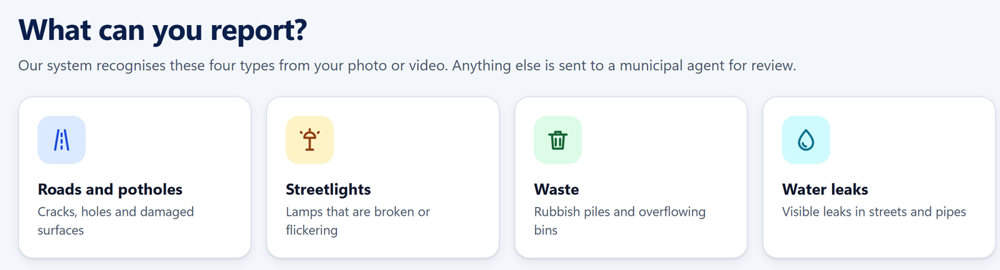</p>

### Step 1: describe the problem

The form has three steps. In **step 1** the citizen writes what they see (up to 3,000 characters) and, optionally, where it is (a street, neighbourhood or landmark). The location is **never guessed from the photo**: only what the citizen types is used. The page asks citizens to leave out names and phone numbers.

### Step 2: add the evidence

The citizen chooses **one** of two modes:

| Mode | What can be sent | Limits shown in the form |
|---|---|---|
| **Photo** | One photo, plus an optional voice note that replaces the written description | JPG, PNG or WEBP up to 10 MB; voice note up to 2 minutes and 30 MB |
| **Video** | A single short video | MP4, WEBM or MOV, up to 1 minute and 50 MB |

### Step 3: send it once

The citizen clicks **Send complaint**. The page then shows a progress message with the elapsed time while the agents work. The submission is protected against double sending (the same request cannot create two tickets).

<p align="center">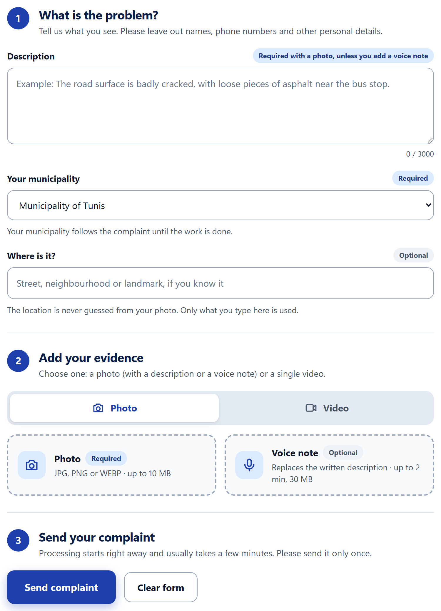</p>

### On a phone

The portal is responsive (checked down to a 320 px screen width), has keyboard-accessible tabs, visible focus rings and respects reduced-motion settings.

<p align="center">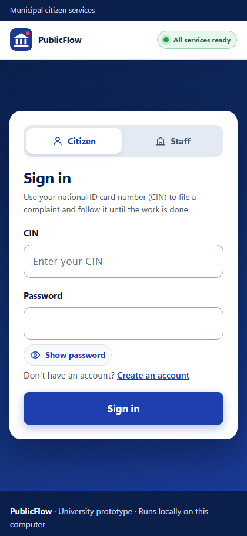</p>

---

## 3. What the citizen gets back

When processing finishes, the page shows the **decision**, the **tracking ID** and what the system understood. The example below is a **real run** (a photo of damaged asphalt):

<p align="center">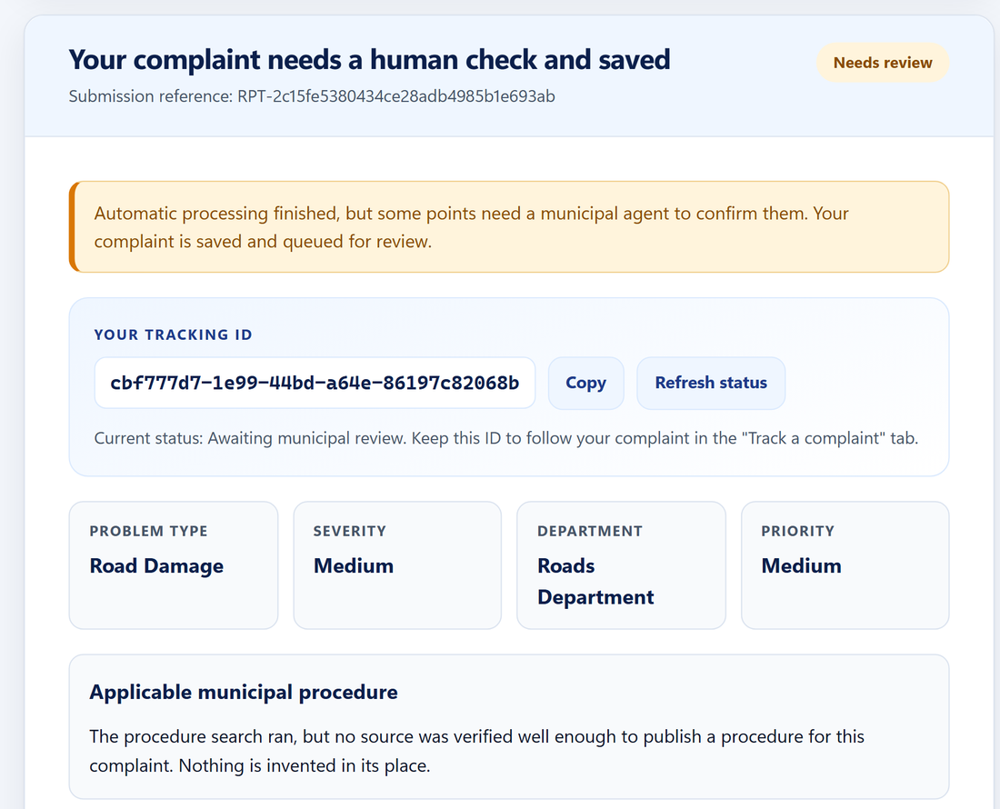</p>

Key things on this page:

- **Decision badge:** PASS, REVIEW or REJECT (see the table below).
- **Tracking ID:** a 36-character ID with a **Copy** button and a **Refresh status** button that reads the current status from the database.
- **Problem type, severity, department, priority:** the department comes from a fixed rule, not from an AI model.
- **Applicable municipal procedure:** shown **only** if it was verified against real sources. Otherwise the page says so openly: *"Nothing is invented in its place."*
- **Points flagged for review:** the exact reason codes, for example `VISION_UNCERTAINTY_REQUIRES_REVIEW`.
- **Processing details:** every step that actually ran, with its result.

<p align="center">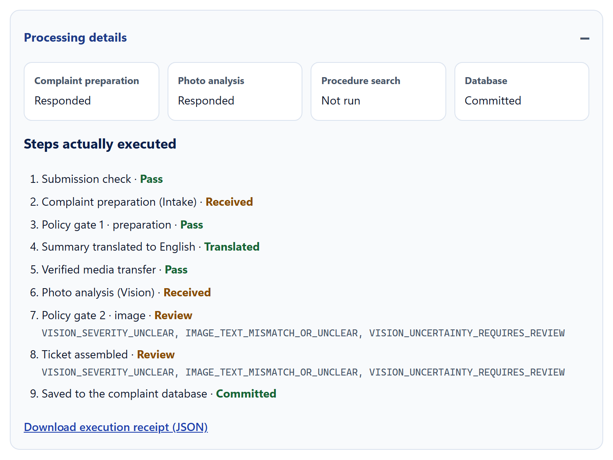</p>

### What the three decisions mean

| Decision | Meaning | What happens |
|---|---|---|
| **PASS** | All checks are satisfied. | Ticket is created as `OPEN`. |
| **REVIEW** | The AI is uncertain, or evidence is weak or missing. | Ticket is saved as `NEEDS_REVIEW` with a review record for a human. |
| **REJECT** | The input is invalid or unsupported. | Ticket is saved as `REJECTED`. |

Ticket statuses stored in the database: `OPEN`, `NEEDS_REVIEW`, `IN_PROGRESS`, `RESOLVED`, `REJECTED`. The system **never silently continues** when something is uncertain.

### Tracking a complaint later

The **Track a complaint** tab takes the tracking ID and reads the ticket back from PostgreSQL (through an n8n webhook). It works even after the services restart, because the ticket is stored in the database, not in the page.

<p align="center">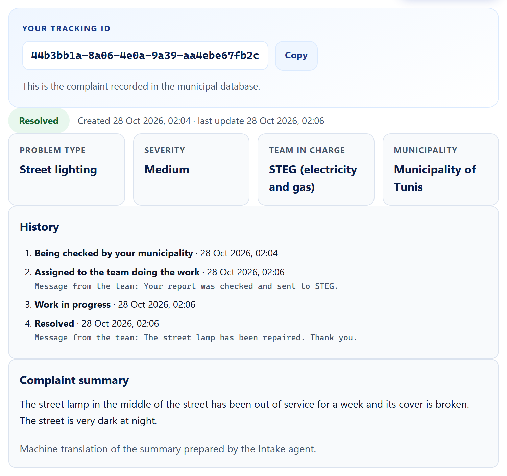</p>

> The summary in this screenshot is in French because the Intake Agent normalises text into French for the downstream agents.

### After sending: what happens next

<p align="center">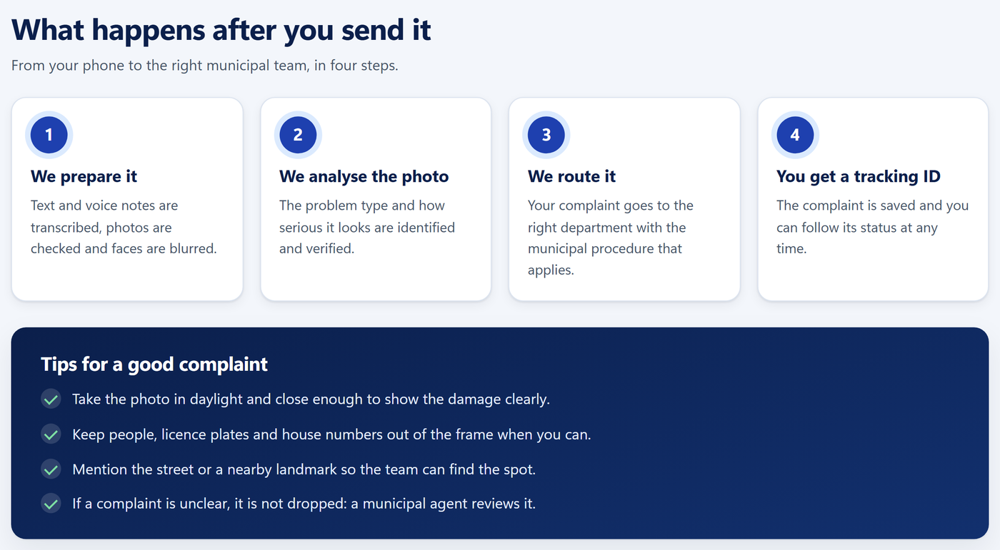</p>

---

## 4. How a complaint flows through the system

```mermaid
flowchart LR
    C([Citizen]) --> P[Web portal<br/>port 8090]
    P --> N{{n8n workflow<br/>the conductor}}
    N --> IC[Input check]
    IC --> IA[1. Intake Agent]
    IA --> G1{Gate 1}
    G1 --> VA[2. Vision Agent]
    VA --> G2{Gate 2}
    G2 --> R[Router<br/>fixed rules]
    R --> KA[3. Knowledge Agent<br/>RAG]
    KA --> G3{Gate 3}
    G3 --> T[Assemble ticket]
    T --> DB[(PostgreSQL)]
    DB --> ID([Tracking ID<br/>back to the citizen])
```

**Key rule:** AI is used to *understand* things (what is in the image, what the text means). **Fixed, testable rules** make the decisions (which department, PASS or REVIEW or REJECT, how the ticket is formatted).

### The same flow as a sequence

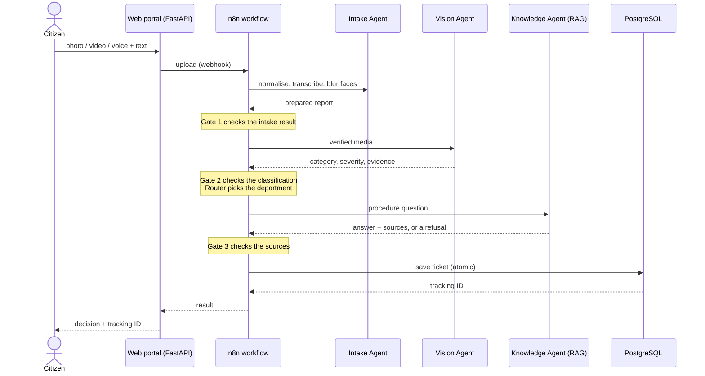

### What happens when a step fails (as observed in recorded runs)

- **Intake not usable** (for example `INTAKE_PROVENANCE_INVALID`): the workflow stops early, does not call Vision or Knowledge, and still saves a `REVIEW` ticket. These runs finished in about 2 seconds.
- **Vision uncertain** (`VISION_UNCERTAINTY_REQUIRES_REVIEW`): the uncertainty is kept as a review reason and the workflow **continues**, so the router and the Knowledge Agent still run.
- **No supported procedure** (`KNOWLEDGE_NO_SUPPORTED_ANSWER`): the ticket is still saved, with no procedure published.
- **Database down:** the portal answers with a clean error and **never** shows a false "saved" message.

### The n8n workflow

The full workflow, `municipalCompletionDev`, has **62 nodes and 72 connections**: 30 Code nodes (gates and rules), 15 IF branches, 11 HTTP calls to the agents, 2 webhooks, 2 responses and 2 PostgreSQL nodes. Videos are analysed frame by frame (up to three frames), then aggregated.

<p align="center">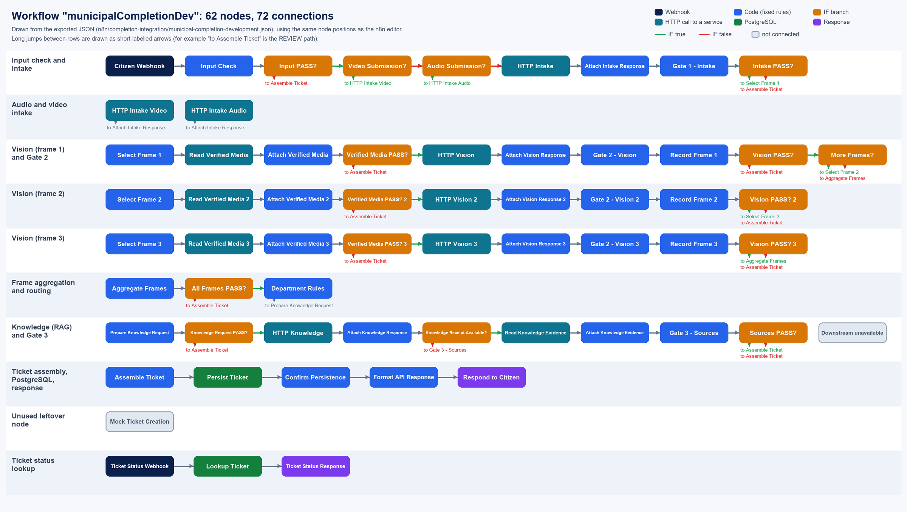</p>

*This diagram is drawn from the exported workflow file `n8n/completion-integration/municipal-completion-development.json`, using the same node positions as the n8n editor. Long jumps between rows are shown as short labelled arrows. Three nodes in the file are not connected (leftovers from earlier versions).*

You can watch real runs in n8n at `http://127.0.0.1:5679/` under **Executions**.

---

## 5. The building blocks, one by one

### 5.1 Web portal: `integration/portal/`

The citizen-facing page (and the operator setup page). It never calls the AI agents directly: it sends uploads to n8n and shows the result.

- **Tech:** Python **FastAPI** backend, plain **HTML + CSS + JavaScript** front end (no framework, no build step).
- **Routes:** `GET /` (portal), `GET /setup` (operator page), `GET /api/health`, `GET /api/session`, `POST /api/reports` (submit, returns `202`), `GET /api/reports/{id}` (progress and result), `GET /api/tickets/{tracking_id}` (ticket lookup), `POST /api/setup/intake` (store the NVIDIA key).
- **Good to know:** one complaint is processed at a time; submissions carry an idempotency key; results are kept as local execution receipts.

The **operator setup page** (`/setup`) shows which local services are up and lets the person running the demo store the NVIDIA key once:

<p align="center">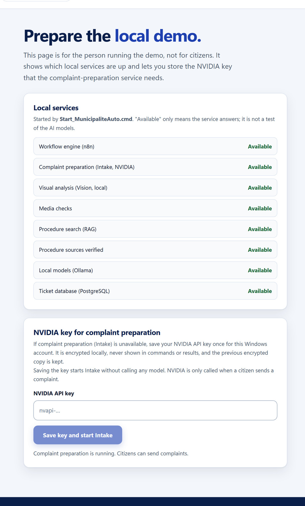</p>

### 5.2 n8n workflow: `n8n/`

n8n is the **orchestrator**: it receives the upload through a webhook, calls each agent over HTTP, runs the gates and the router as Code nodes, writes the ticket and answers the portal. Every run is stored in n8n's execution history, which is the main audit trail.

- **Tech:** **n8n 2.42.6** in Docker (image pinned by digest), timezone `Africa/Tunis`.
- **How it is built:** the workflow JSON files are *generated* by `build_workflow.py` scripts. The logic of each step lives in small JavaScript files under `nodes/` (for example `gate2.js`, `gate3.js`), so rules can be read and tested without opening the editor.
- **Webhooks:** `municipal-ticket-development` (new complaint) and `municipal-ticket-status` (ticket lookup).

### 5.3 Agent 1, Intake: `intake-agent/`

Prepares the raw submission so the next agents receive clean, safe input.

| It does | How |
|---|---|
| Detects the language and **cleans the text into French** | Hosted NVIDIA model `nvidia/nemotron-3.5-lightning-30b-a3b` with a versioned French-normalisation prompt |
| **Transcribes voice notes** | NVIDIA-hosted `openai/whisper-large-v3` |
| **Extracts frames from videos** | FFmpeg |
| **Blurs faces** for privacy | YuNet face detector (ONNX, from the OpenCV Zoo) |

- **Tech:** Python 3.11 service (FastAPI + Pydantic) on port 8012, media helper on port 8013.
- **Needs a cloud key:** the NVIDIA models are hosted, so each user needs **their own NVIDIA API key**. The key is stored encrypted for the Windows account and is never shown in commands or results.
- **Checked by Gate 1** before Vision runs. Example reason codes: `INTAKE_PREPARATION_INCOMPLETE`, `INTAKE_PROVENANCE_INVALID`.

### 5.4 Agent 2, Vision: `vision-agent/`

Looks at the (anonymised) photo and returns a strict JSON answer:

`category` · `severity` · `description` · `evidence` (what is visible) · `text_image_consistent` · `confidence` · `uncertainty_reason`

- **Tech:** FastAPI service on port 8010; runs **locally** with **Ollama** and the vision-language model **`qwen2.5vl:3b`**, using structured (JSON schema) output.
- **Categories:** `ROAD_DAMAGE`, `STREET_LIGHTING`, `WASTE`, `WATER_LEAK`.
- **Prompt engineering study:** the folder contains **115 logged experiments across 11 prompt versions** (`prompts/vision/experiment_log.csv`). Techniques tried: role prompting, zero-shot, few-shot, structured output, visual grounding, uncertainty guardrails and prompt chaining.

  | What we learned | Evidence |
  |---|---|
  | Structured JSON output and fixed labels from the first version | v1 onwards |
  | Few-shot examples (v3) made the model **invent waste** on one photo, so v3 stayed experimental | experiment log |
  | Prompt chaining (v5) was tried and **rejected** | experiment log |
  | No independent test set exists yet, so severity and confidence are **unvalidated** | experiment log |

### 5.5 Agent 3, Knowledge (RAG): `rag-agent/`

Finds the municipal procedure that applies to the problem. **RAG** means the AI first *looks up* documents, then answers using **only** what it found.

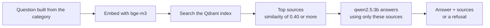

- **Tech:** FastAPI service on port 8020; **bge-m3** embeddings (1,024 dimensions, 8,192-token context); an **embedded Qdrant** vector index (local files, no server); the local **`qwen2.5:3b`** model for generation, on a second Ollama instance (port 11435). An **evidence bridge** (port 8021) verifies a receipt proving which indexed passages were actually used.
- **Corpus:** a small library of source documents about the **Commune de Tunis** (9 enabled documents), indexed with two chunking strategies (*structure*: 12 chunks, *fixed*: 9 chunks).
- **No invention:** if no source supports an answer, the agent says so (it refuses) and returns no procedure.

### 5.6 Policy gates and the router (inside n8n)

Three checkpoints written as **plain JavaScript, with no AI**. Each outputs PASS, REVIEW or REJECT with exact reason codes.

| Gate | Checks | Example reason codes |
|---|---|---|
| **Gate 1** | The intake result is complete and its provenance is valid | `INTAKE_PREPARATION_INCOMPLETE` |
| **Gate 2** | The Vision output follows its contract: allowed category, severity `LOW/MEDIUM/HIGH`, evidence present, text and image consistent, **no stated uncertainty** | `VISION_UNCERTAINTY_REQUIRES_REVIEW` |
| **Gate 3** | The procedure is backed by real sources: 1 to 3 sources, valid IDs and URLs, similarity of at least 0.40, retrieval receipt verified, procedure quoted from the retrieved text | `KNOWLEDGE_NO_SUPPORTED_ANSWER` |

Design choices worth noting: Gate 2 sets **no confidence threshold**, because the model's confidence is an uncalibrated estimate, not evidence of correctness.

The **router** is a lookup table. **No language model chooses the department:**

| Category | Department |
|---|---|
| `ROAD_DAMAGE` | `ROADS_DEPARTMENT` |
| `STREET_LIGHTING` | `PUBLIC_LIGHTING_DEPARTMENT` |
| `WASTE` | `SANITATION_DEPARTMENT` |
| `WATER_LEAK` | `WATER_SERVICES_DEPARTMENT` |

### 5.7 Ticket database: `integration/persistence/`

PostgreSQL stores tickets, review records and a full history of changes, in the `municipal` schema:

| Table | Purpose |
|---|---|
| `municipal.tickets` | One row per complaint: tracking ID, decision, status, full payload, version |
| `municipal.review_records` | A pending record for every `REVIEW` ticket (reason codes and policy) |
| `municipal.ticket_events` | Append-only history: event, actor, details, timestamp |

The database itself enforces important rules, through the SQL functions `save_report` and `ticket_status`:

- **Atomic:** a save is one transaction, all or nothing.
- **Idempotent:** the same report ID with the same content returns the same ticket; the same ID with *different* content is rejected (`REPORT_ID_CONTENT_CONFLICT`). Concurrent saves of one report are serialised with an advisory lock.
- **Verified:** the database **refuses a PASS** unless all three gates passed (`UNVERIFIED_TICKET_CANNOT_AUTO_PASS`) and refuses to publish a procedure when Gate 3 did not pass. So even a bug in the workflow cannot store an unverified PASS.

---

### 5.8 Staff console: `integration/staff/`

The second web application (port 8091), in French, for the people who handle tickets after the AI. Three roles, each with its own screen:

| Role | Sees | Does |
|---|---|---|
| **Municipality** (one account per commune) | Every ticket of **its** commune, whatever the type | Reviews uncertain tickets, corrects category and severity, assigns the work (its own services, STEG or SONEDE), reassigns, rejects, reopens |
| **STEG / SONEDE** | Only the work assigned to it | Starts the work, marks it **done** or **not done** (the ticket then returns to the commune) |
| **Maintenance administrator** | Service health and anonymous counts, **never ticket content** | NVIDIA key, staff accounts, list of communes |

```
Citizen → AI agents + gates → commune reviews / corrects / assigns
                                 ├─ commune services (roads, waste)
                                 ├─ STEG (street lighting)
                                 └─ SONEDE (water leaks)
                                       → done      → RESOLVED, visible to the citizen
                                       → not done  → back to the commune
```

- **Routing proposal:** *Department Rules* adds the executing organisation (fixed table). The commune confirms or changes it; the AI's original classification is kept beside any human correction.
- **Enforced in the database:** `integration/persistence/staff_schema.sql` (additive migration) defines `municipal.staff_api`, which checks who may see and change each ticket, optimistic versions and mandatory notes. A forged or out-of-scope request gets `TICKET_NOT_FOUND` or `STAFF_ACTION_FORBIDDEN`.
- **Passwords never reach n8n:** accounts are scrypt hashes in `.runtime/staff/`. The console sends n8n only the agent's name, role and organisation, through a header-authenticated webhook (`municipal-staff`).
- **Citizen side:** the portal now asks for the commune (never inferred) and the tracking page shows the timeline and the public message left by the organisation. Internal notes and agent names are never shown.
- The former `/setup` page of the portal now redirects to the authenticated administrator console.

## 6. Technology stack

| Layer | Technology | Role | Where |
|---|---|---|---|
| Web portal | FastAPI, HTML, CSS, JavaScript | Citizen and operator pages, API | `integration/portal/` |
| Orchestration | **n8n 2.42.6** (Docker, pinned digest) | Runs the workflow, webhooks, audit trail | `n8n/` |
| Agent APIs | FastAPI + Pydantic (Python 3.11) | HTTP contract of the Intake, Vision and Knowledge services | `intake-agent/`, `vision-agent/`, `rag-agent/` |
| Intake model | NVIDIA-hosted `nemotron-3.5-lightning-30b-a3b` | Language detection, French text normalisation | `intake-agent/` |
| Speech-to-text | NVIDIA-hosted `openai/whisper-large-v3` | Transcribes voice notes | `intake-agent/` |
| Privacy and media | YuNet (ONNX), FFmpeg | Face blurring, video frames and audio | `vendor/media`, `integration/vision/` |
| Vision model | **`qwen2.5vl:3b`** on Ollama (local) | Classifies the photo | `vision-agent/` |
| Embeddings | **`bge-m3`** on Ollama (local) | Turns text into vectors for search | `rag-agent/` |
| Vector store | **Qdrant**, embedded mode | Similarity search over the corpus | `rag-agent/` |
| Answer model | **`qwen2.5:3b`** on Ollama (local) | Answers using only retrieved passages | `rag-agent/` |
| Database | **PostgreSQL 17.10** (Docker, pinned digest) | Tickets, reviews, history, SQL rules | `integration/persistence/` |
| Runtime | Python 3.11.15 (bundled), Docker Compose, PowerShell launcher | Reproducible local demo | `distribution/` |
| Integrity | SHA-256 manifest, Windows DPAPI | File verification, encrypted API key | `PACKAGE_MANIFEST.json` |

---

## 7. Key figures and KPIs

All numbers below were counted or measured from this repository and the runs stored on the development machine. Where a number is a small sample, it says so.

### 7.1 Project scale

| Indicator | Value |
|---|---|
| AI agents | **3** (Intake, Vision, Knowledge) |
| Policy gates | **3** (each PASS, REVIEW or REJECT) |
| n8n workflow | **62 nodes**, 72 connections (30 Code, 15 IF, 11 HTTP, 2 webhooks, 2 responses, 2 PostgreSQL) |
| Incident types recognised | **4** |
| Source code | about **12,000 lines** in 147 tracked files (Python 87, JavaScript 26, PowerShell 24, HTML 4, others) |
| Prompt experiments (Vision) | **115 runs**, 11 prompt versions (109 on `qwen2.5vl:3b`, 6 on `qwen3-vl:2b`) |
| Automated checks | 4 unit-test files, 14 verification scripts and 1 credential-check script |

### 7.2 Quality of each stage

| Stage | Metric | Result | Caveat |
|---|---|---|---|
| **Knowledge (RAG), integrated system** | Retained **Hit@3** on the 9 positive development questions | **5/9** (structure chunks), **6/9** (fixed chunks) | Two expected sources are excluded from the corrected corpus; the unrelated control question still retrieved context |
| **Knowledge, original archive replay** | Hit@1 / Hit@3 / MRR | Structure **6/9, 9/9, 0.833**; fixed **8/9, 9/9, 0.926** | Older 12-document corpus and different embedding runtime, so not comparable with the line above |
| **Intake text cleaning** | Predeclared checks passed on a 13-case fixture | **10/13** (NVIDIA Nemotron) vs **7/13** (local Qwen3 4B) | Small fixture comparison, not general accuracy |
| **Intake latency** | HTTP response time | median **1.4 s** (0.9 to 3.0 s) | 13 requests in one benchmark |
| **Vision** | Structured-output validity and abstention behaviour | Tracked per prompt version in the experiment log | **No independent test set**: severity and confidence are unvalidated |

### 7.3 Operational results (8 recorded runs on the development machine)

| Indicator | Value |
|---|---|
| Runs recorded | **8** |
| Full runs (Intake, Vision and Knowledge all responded) | **3**, each taking **43 to 48 seconds** end to end |
| Runs stopped early at Intake | **5** (the first integration tests on 22 October), about **2 seconds** each |
| Decisions | **0 PASS, 8 REVIEW, 0 REJECT** |
| Tickets committed to PostgreSQL | **8 of 8** |
| Reasons for REVIEW in the full runs | `VISION_UNCERTAINTY_REQUIRES_REVIEW` and `KNOWLEDGE_NO_SUPPORTED_ANSWER` in all 3 |

> The original documentation reports **3 to 9 minutes** per run on the source PC. The 43 to 48 seconds above were measured on this machine, which runs the local models faster. Expect the time to depend heavily on your hardware.

### 7.4 What a ticket stores (and what a dashboard could track)

Every ticket records: category, severity, department, priority, a summary, the three gates' decisions with reason codes, the verified procedure and sources (if any), a full execution trace, and timestamps with a version number. From this data a reporting dashboard (**not built yet**; the staff console shows counts per status) could report, for example: the PASS / REVIEW / REJECT rate, the most common review reasons, time from submission to first human action, and tickets per department and status.

---

## 8. Design principles

- **n8n stays the backbone.** Each agent runs one after another.
- **AI interprets; rules decide.** Routing, policy and ticket formatting are deterministic.
- **Validate between every stage.** Outputs are checked against a contract before the next step uses them.
- **Never invent anything.** No made-up procedures, classifications or locations. RAG answers must come from retrieved sources.
- **Privacy first.** Faces are anonymised and sensitive data is not exposed.
- **Uncertain means REVIEW.** Human review is a real, stored record, not just an idea.
- **Defence in depth.** The database re-checks the gates.
- **Keep traces.** Executions, agent versions and errors are recorded.
- **Be honest about results.** Mocked or simulated runs are never presented as real AI inference.

---

## 9. Security and privacy

- **Local only:** every service is bound to `127.0.0.1`; the portal accepts only local hosts and origins.
- **Portal hardening:** strict Content Security Policy, a per-session token compared in constant time, upload size and form-field limits, `no-store` caching, and a lock so only one complaint is processed at a time.
- **No secrets in the repository:** `.runtime/` and `vendor/` are ignored. The NVIDIA key is encrypted with Windows DPAPI. The packaging script uses an allow-list and scans for key-like text.
- **Reproducible images:** Docker images are pinned by SHA-256 digest.
- **Privacy by design:** faces are blurred during intake; the location is never inferred; citizens are asked not to include personal data.
- **Known limits:** there is **no login**, the tracking ID acts like a password, and the Intake Agent sends text and audio to NVIDIA's hosted models. Do not expose the demo to the internet.

---

## 10. Repository map

```
PublicFlow/
├── README.md                  <- you are here
├── AGENTS.md                  project context and rules for AI coding assistants
├── READ_ME_FIRST.txt          step-by-step guide for running the packaged demo
├── Start_MunicipaliteAuto.cmd double-click launcher (Windows)
├── PACKAGE_MANIFEST.json      file hashes checked at launch (see warning below)
│
├── docs/images/               screenshots and the workflow diagram used in this README
├── demo/                      sample photo + description to try the system
├── distribution/              launcher scripts, Docker compose, packaging tools
│
├── intake-agent/              Intake Agent (media handling, privacy, text cleaning)
├── vision-agent/              Vision Agent (image classification, prompt study)
├── rag-agent/                 Knowledge Agent (corpus, retrieval, evaluation, report)
│
├── n8n/                       workflow builders and generated workflow JSON
│   ├── intake-integration/
│   ├── vision-integration/
│   ├── knowledge-integration/
│   └── completion-integration/   <- the full, final workflow
│
├── integration/               glue code that connects each agent to n8n
│   ├── portal/                citizen web interface
│   ├── intake-local/          NVIDIA key setup and benchmarks
│   ├── vision/                media bridge for video and audio
│   ├── knowledge/             Knowledge API launcher and evidence bridge
│   └── persistence/           PostgreSQL schema and setup
│
└── project-docs/              integration evidence reports
```

> **Warning:** the launcher checks a SHA-256 hash of every file listed in `PACKAGE_MANIFEST.json`. If you edit a listed file (even `README.md` or `.gitignore`) without regenerating the manifest, the launcher refuses to start. New files that are not in the manifest are fine.
>
> The folders `vendor/` (about 685 MB of bundled Python, libraries and FFmpeg) and `.runtime/` are **not stored in git**. To run the demo you need the complete ZIP package, not just a `git clone`.

---

## 11. Run the demo

### Requirements
- Windows 10 or 11 (64-bit)
- **Docker Desktop** (Linux containers mode)
- **Ollama**, with these models installed: `qwen2.5vl:3b`, `qwen2.5:3b`, `bge-m3:latest`
- An **NVIDIA API key** (free tier), for the Intake Agent
- Internet access for the first run
- Roughly 2 GB of disk space, plus Docker images and enough RAM for the local models

### Steps
1. Extract the **whole ZIP package** into a **short folder path** such as `C:\Municipal`.
2. Start **Docker Desktop** and **Ollama**.
3. Double-click **`Start_MunicipaliteAuto.cmd`** and leave the window open. The first launch builds the search indexes and imports the workflow, which can take several minutes.
4. Open <http://127.0.0.1:8090/setup> and enter your NVIDIA key once. It is encrypted for your Windows account and never stored in plain text.
5. Open <http://127.0.0.1:8090/>, upload `demo/road-damage.jpg`, paste the text from `demo/description.txt` and click **Send complaint** once.
6. Wait for processing (under a minute on a fast machine, up to several minutes on a laptop). The page then shows the ticket, the decision and the tracking ID.

To watch the workflow run, open n8n at <http://127.0.0.1:5679/>, create your local owner account the first time, and go to **Executions**.

### Troubleshooting
- **Port already in use:** close the earlier run and retry.
- **Setup interrupted:** run `Start_MunicipaliteAuto.cmd` again. Credentials are reused.
- **Do not delete Docker volumes to fix a startup error.** They hold your saved tickets.
- Logs are in `.runtime/portal/services` and `.runtime/knowledge-ollama`.

---

## 12. Ports and services

| Port | Service |
|---|---|
| 8090 | Citizen web portal |
| 8091 | Staff console (municipality, STEG, SONEDE, maintenance admin) |
| 5679 | n8n workflow editor and webhooks |
| 5434 | PostgreSQL ticket database |
| 8010 | Vision Agent API |
| 8012, 8013 | Intake and media services |
| 8020 | Knowledge Agent API |
| 8021 | Evidence verification bridge |
| 11434 / 11435 | Ollama (Vision / RAG) |

Everything is bound to `127.0.0.1` (your own computer only).

---

## 13. Testing and verification

The repository holds **4 unit-test files** (Vision prompts and delivery, RAG contract and API queries) and **14 verification scripts** that exercise the real integration:

| Area | Scripts |
|---|---|
| Database | `integration/persistence/verify_live.py`, `check_outage.py`, `verify_execution_recording.py` |
| Knowledge | `integration/knowledge/verify_offline.py`, `validate_live.py`, `validate_deployment.py`, `check_engine.py` |
| Video and audio | `integration/vision/verify_multimedia_offline.py`, `validate_multimedia_live.py`, `check_multimedia_engine.py` |
| Package | `distribution/smoke.py`, `distribution/verify_backend.py` |
| RAG delivery | `rag-agent/Knowledge_Agent/scripts/check_setup.py`, `smoke_knowledge.py` |
| Intake key | `integration/intake-local/Test_NVIDIA_Credentials.ps1` (NVIDIA credential check) |

Behaviour confirmed with **real runs** (not mocks):

- Upload through the portal, then Intake, Vision, Knowledge, all three gates, and a saved PostgreSQL ticket.
- Tracking a ticket by ID, including after a database restart.
- A clean 503 error, with no false "saved" message, when the database is down.
- Invalid input is rejected and saved as `REJECTED`, and resubmitting does not create duplicates.

---

## 14. Current status and limitations

**Working (verified with real runs):** see the list in section 13, plus the 8 recorded runs in section 7.3.

**Known limitations:**
- **Staff console not yet verified live.** The console, the n8n staff workflow and the SQL migration are built and covered by contract tests (`integration/staff/test_staff.py`, `integration/portal/test_portal_commune.py`) and by a throwaway-database rehearsal (`integration/persistence/verify_staff_schema.py`). A full run through the live n8n and PostgreSQL containers still has to be recorded.
- **Photos are not shown to staff.** Only the media fingerprint is stored in the database, so the console shows the AI's description and evidence, not the photo itself.
- **Only four incident types are implemented.** Damage to public property is not classified and is sent to review.
- **No all-PASS demo case recorded.** All 8 recorded runs ended as `REVIEW` or earlier: Vision was uncertain and the RAG corpus had no supported procedure.
- **RAG is still modest.** Retained Hit@3 is 5/9 and 6/9 in development tests, on a small corpus (9 enabled documents).
- **No independent test set** for Vision, so severity and confidence are not validated.
- **Three unconnected nodes** remain in the exported workflow (for example `Mock Ticket Creation`, a leftover from the earlier simulated version).
- **Local demo only.** No login, and the tracking ID acts like a password. One complaint at a time.
- **Needs a cloud key.** Intake uses NVIDIA's hosted models, so it is not fully offline.
- **Some test suites and the original design documents are not in this repository.** Some READMEs mention them.

**Natural next steps:** a recorded live run of the staff console, an Arabic version of the citizen portal, a labelled evaluation set to measure accuracy and calibrate confidence, a larger corpus with better retrieval, more incident types, authentication and a job queue.

---

## 15. Glossary

| Term | Plain meaning |
|---|---|
| **Agent** | A program that uses an AI model to do one specialised job. |
| **n8n** | A visual workflow tool that runs the steps in order. |
| **Multimodal** | Handling more than one kind of input: images, audio, video and text. |
| **RAG** | Retrieval-Augmented Generation. The AI first looks up documents, then answers using only them. |
| **Corpus** | The collection of source documents the Knowledge Agent searches. |
| **Embedding** | A numeric fingerprint of text that lets the computer find similar passages. |
| **Qdrant** | The vector database that stores those fingerprints. |
| **Ollama** | A tool for running AI models on your own computer. |
| **Policy gate** | A fixed-rule checkpoint that outputs PASS, REVIEW or REJECT. |
| **Hit@k** | Share of questions where the correct source appears in the top *k* retrieved results. |
| **MRR** | Mean Reciprocal Rank: the average of 1 / (rank of the correct source). Higher is better. |
| **Idempotent** | Doing the same action twice has the same result as doing it once. |
| **Webhook** | A web address that receives data and starts a workflow. |
| **CSP** | Content Security Policy: a browser rule limiting what a page may load or run. |

---

## 16. Where to read next

| If you want to understand... | Read |
|---|---|
| How to run the packaged demo | `READ_ME_FIRST.txt` |
| The citizen portal | `integration/portal/README.md` |
| Database, tickets and review records | `integration/persistence/README.md` |
| The Knowledge Agent integration | `integration/knowledge/README.md` |
| The RAG research and evaluation | `rag-agent/Knowledge_Agent/docs/research/rag.md` |
| The Vision Agent and prompt study | `vision-agent/Vision_Agent/02_VISION_PROJECT/README.md` |
| The Intake Agent (NVIDIA) | `integration/intake-local/README-nvidia.md` |
| Project rules and context | `AGENTS.md` |
